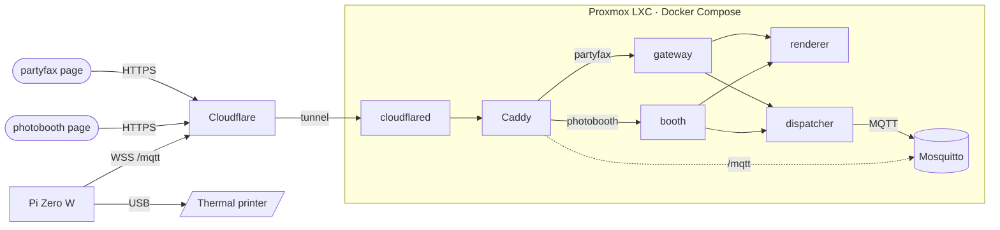

<div align="center">

# 📠 partyfax

**One receipt printer at my place. Two ways to print to it.**

[](https://partyfax.nilanet.live)
[](https://photobooth.nilanet.live)

[](https://github.com/jstader/partyfax/actions/workflows/ci.yml)


[](LICENSE)

</div>

<br>

A thermal receipt printer sits at my place, driven by a Raspberry Pi. Two
separate sites print to it, each with its own page, API service and wall,
and both go through the same back end to the same printer:

| | **partyfax** | **photobooth** |
| --- | --- | --- |
| **Address** | [partyfax.nilanet.live](https://partyfax.nilanet.live) | [photobooth.nilanet.live](https://photobooth.nilanet.live) |
| **Who** | anyone on the internet | guests at a party, with the event's code |
| **You print** | a note or a photo on a receipt | a four-photo strip from your phone's front camera |
| **The wall** | public, at [/prints](https://partyfax.nilanet.live/prints) | private to each event, at /wall |
| **Limits per visitor** | 5 prints a minute, 50 an hour, 100 a day | none: the event code keeps strangers out |
| **Run by** | nobody: it's open | the host, from an admin page behind Cloudflare Access |
| **Page** | `frontend/` | `frontend/booth/` |
| **API service** | `gateway` | `booth` |

## partyfax: a receipt anyone can print

> [!TIP]
> **Print me something at [partyfax.nilanet.live](https://partyfax.nilanet.live).**\
> It comes out of the printer a few seconds later.

You write on a receipt in your browser, swipe it off the top of the screen,
and the printer prints it. There's no app and no account. Everything
printed shows up on the public wall at
[/prints](https://partyfax.nilanet.live/prints).

| | |
| --- | --- |
| **Paper** | 9 lines × 32 characters |
| **Styles** | bold, underline, white-on-black |
| **Photos** | dithered to 1-bit in your browser, 384 dots wide |
| **Feedback** | the site says "printed" only once the printer has taken the job |

## photobooth: photo strips at a party

The host creates an event on the admin page (`/admin`, behind Cloudflare
Access) and themes its strips: a frame, a title and subtitle, a font, and
up to six pixel-art icons (hearts, pumpkins, snowflakes and more). The page
gives the event a six-character code, a link with the code built in, and a
sign with a QR code to print and stand by the printer.

A guest scans the sign or types the code once, then:

1. taps **Enter the photobooth**,
2. gets a countdown, and the front camera takes four photos a few seconds
   apart (the host sets both countdowns),
3. sees the finished strip, and taps **Print it** or **Retake**.

The strip prints as a classic photo-booth strip, about 16 cm long. Each
event has its own wall of strips, which guests can swipe through on a
phone, download or share, and reprint. The host can hide or delete strips,
download them all as a zip, and turn the event off when the party's over.
Wrong codes are counted on every request, so codes can't be guessed.

## One back end for both



Each front end has its own page and its own API service, which knows that
front end's rules: what a receipt may contain, which event a code opens.
Everything after that is shared. Both services hand the renderer a
document or a picture, and the dispatcher a print job; neither knows the
other exists.

Nothing is port-forwarded. Both the server and the printer connect *out*:
the server's `cloudflared` dials Cloudflare, and the Pi dials the site's
MQTT websocket. A print request waits the whole way through, so the page
gets its answer only after the printer has acked the job.

<details>
<summary><b>The pieces</b></summary>
<br>

**partyfax only**

- **Page** (`frontend/`): vanilla JS with no build step. It lays text out on
  the paper grid, dithers photos, and posts to `POST /api/print`.
- **gateway** (`backend/cmd/gateway`): checks a receipt fits the paper,
  prints it, and keeps the public wall.

**photobooth only**

- **Pages** (`frontend/booth/`): the booth, the event wall, a strip's own
  page, and the admin page. The strip is composed and dithered on the
  phone, so the preview is exactly what prints.
- **booth** (`backend/cmd/booth`): events and their themes, event codes,
  each event's strips, and the admin API, which checks the Cloudflare Access
  token itself too.

**Shared**

- **Cloudflare Tunnel**: terminates HTTPS for both addresses. The
  `cloudflared` container carries requests to Caddy, so the LXC publishes no
  ports.
- **Caddy**: sends each address to its page and API service, and
  rate-limits prints by the visitor's real address (`Cf-Connecting-IP`).
- **renderer**: turns text, a photo or a strip into the printer's own
  command bytes (ESC/POS).
- **dispatcher**: publishes the job over MQTT and waits for the printer to
  answer.
- **Mosquitto**: the message broker. The printer's account can receive jobs
  but never create them.
- **Pi Zero W** (`pi/`, Go): sits next to the printer, with the printer on
  its USB OTG port. It checks for paper, writes the bytes through Linux's
  `usblp` driver, and acks back.
- **Dithering** (`frontend/js/photo.js`): the same code and settings for
  partyfax photos and photobooth strips.

</details>

## Hardware

- **Thermal receipt printer:** an EM5822H embedded module, 58 mm paper, 384
  dots a line, ESC/POS over USB, run at 7.7 V.
- **Raspberry Pi Zero W v1.1**, running Raspberry Pi OS Lite (32-bit), with
  the printer on the inner micro-USB port through an OTG adapter.
- **Server:** an unprivileged LXC on my Proxmox host, running the Docker
  Compose stack.

## Repository

```
frontend/                partyfax: the receipt page and the /prints wall
frontend/booth/          photobooth: booth, event wall, strip page, admin page
frontend/js/             partyfax's modules; photo.js and scale.js serve both
backend/cmd/gateway/     partyfax's API service
backend/cmd/booth/       photobooth's API service
backend/cmd/renderer/    shared: document or picture to printer bytes
backend/cmd/dispatcher/  shared: hands jobs to the printer over MQTT
backend/internal/        shared Go packages
pi/                      the printer agent for the Pi Zero W (Go)
deploy/                  Caddy, Mosquitto, deploy and log scripts
provisioning/            LXC host setup: SSH, CrowdSec, firewall
```

## Running it

- **Server:** [`deploy/README.md`](deploy/README.md) covers secrets, the
  broker accounts, the tunnel and both hostnames, the photobooth's Access
  app, deploying with `./deploy/update.sh`, and backups.
- **Pi:** [`pi/README.md`](pi/README.md) covers building the agent, installing
  it as a service, and the printer self-test.

**Tests:**

```sh
cd backend  && go test ./...
cd frontend && npm test
```

## Credits

Forked from [michal-pielka/fax](https://github.com/michal-pielka/fax), which
built the receipt site, the backend and the original ESP32 firmware. This
fork moves it onto a Proxmox LXC behind a Cloudflare Tunnel, swaps the
ESP32-S3 for a Raspberry Pi Zero W, and adds the photobooth.

---

<div align="center">

### [partyfax.nilanet.live](https://partyfax.nilanet.live) · [photobooth.nilanet.live](https://photobooth.nilanet.live)

*The paper is waiting.*

<sub>Code under the <a href="LICENSE">MIT License</a>. Fonts under the SIL Open Font License: <a href="https://fonts.google.com/specimen/VT323"><i>VT323</i></a> by Peter Hull (<a href="frontend/fonts/VT323-OFL.txt">licence</a>), <a href="https://fonts.google.com/specimen/Bebas+Neue"><i>Bebas Neue</i></a> by Dharma Type (<a href="frontend/fonts/BebasNeue-OFL.txt">licence</a>), <a href="https://fonts.google.com/specimen/Pacifico"><i>Pacifico</i></a> by the Pacifico Project Authors (<a href="frontend/fonts/Pacifico-OFL.txt">licence</a>). QR codes by <a href="https://github.com/kazuhikoarase/qrcode-generator">qrcode-generator</a> (MIT).</sub>

</div>
