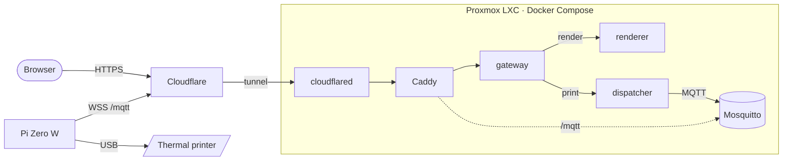

<div align="center">

# 📠 partyfax

**A receipt printer at my place that anyone on the internet can print to.**

[](https://partyfax.nilanet.live)

[](https://github.com/jstader/partyfax/actions/workflows/ci.yml)


[](LICENSE)

</div>

<br>

> [!TIP]
> **Print me something at [partyfax.nilanet.live](https://partyfax.nilanet.live).**\
> It comes out of a thermal printer at my place a few seconds later.

## What it is

You write on a receipt in your browser, swipe it off the top of the screen,
and a thermal printer at home prints it. There's no app and no account.
Everything printed shows up on the wall at
[/prints](https://partyfax.nilanet.live/prints).

| | |
| --- | --- |
| **Paper** | 9 lines × 32 characters |
| **Styles** | bold, underline, white-on-black |
| **Photos** | dithered to 1-bit in your browser, 384 dots wide |
| **Feedback** | the site says "printed" only once the printer has taken the job |
| **Limits** | three prints per visitor every ten minutes |

## How it works



Nothing is port-forwarded. Both the server and the printer connect *out*:
the server's `cloudflared` dials Cloudflare, and the Pi dials the site's
MQTT websocket. A print request waits the whole way through, so the browser
gets its answer only after the printer has acked the job.

<details>
<summary><b>The pieces, in order</b></summary>
<br>

1. **Browser** (`frontend/`): vanilla JS with no build step. It lays text out
   on the paper grid, dithers photos, and posts to `POST /api/print`.
2. **Cloudflare Tunnel**: terminates HTTPS. The `cloudflared` container
   carries requests to Caddy, so the LXC publishes no ports.
3. **Caddy**: routes the site, the API and the MQTT websocket, and
   rate-limits prints by the visitor's real address (`Cf-Connecting-IP`).
4. **gateway** (`backend/`): the public API. It checks the message fits the
   paper, then calls the renderer and the dispatcher.
5. **renderer**: turns text or a photo into the printer's own command bytes
   (ESC/POS).
6. **dispatcher**: publishes the job over MQTT and waits for the printer to
   answer.
7. **Mosquitto**: the message broker. The printer's account can receive jobs
   but never create them.
8. **Pi Zero W** (`pi/`, Go): sits next to the printer, with the printer on
   its USB OTG port. It checks for paper, writes the bytes through Linux's
   `usblp` driver, and acks back.

</details>

## Hardware

- **Thermal receipt printer:** 58 mm, ESC/POS over USB.
- **Raspberry Pi Zero W v1.1**, running Raspberry Pi OS Lite (32-bit), with
  the printer on the inner micro-USB port through an OTG adapter. It also has
  a camera, which isn't used yet. A photobooth mode is planned.
- **Server:** an unprivileged LXC on my Proxmox host, running the Docker
  Compose stack.

## Repository

```
frontend/       the receipt you type on (HTML, CSS, ES modules)
backend/        gateway, renderer and dispatcher (Go)
pi/             the printer agent for the Pi Zero W (Go)
deploy/         Caddy, Mosquitto, deploy and log scripts
provisioning/   LXC host setup: SSH, CrowdSec, firewall, encrypted NAS backups
firmware/       upstream's ESP32-S3 firmware (Rust); not used here
```

## Running it

- **Server:** [`deploy/README.md`](deploy/README.md) covers secrets, the
  broker accounts, the tunnel, deploying with `./deploy/update.sh`, and
  backups.
- **Pi:** [`pi/README.md`](pi/README.md) covers building the agent, installing
  it as a service, and the printer self-test.

**Tests:**

```sh
cd backend  && go test ./...
cd frontend && npm test
```

## Credits

Forked from [michal-pielka/fax](https://github.com/michal-pielka/fax), which
built the site, backend and ESP32 firmware. This fork moves it onto a Proxmox
LXC behind a Cloudflare Tunnel and swaps the ESP32-S3 for a Raspberry Pi
Zero W.

---

<div align="center">

### [partyfax.nilanet.live](https://partyfax.nilanet.live)

*The paper is waiting.*

<sub>Code under the <a href="LICENSE">MIT License</a>. Receipt font: <a href="https://fonts.google.com/specimen/VT323"><i>VT323</i></a> by Peter Hull, under the <a href="frontend/fonts/VT323-OFL.txt">SIL Open Font License</a>.</sub>

</div>
